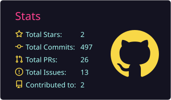
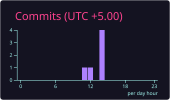
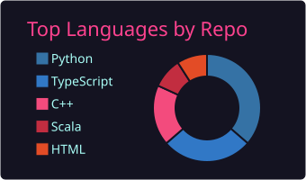
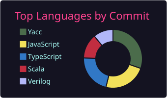

**IIT Kanpur CSE Graduate · Competitive Programmer · Exploring AI & Agentic Workflows**

## 👨‍💻 About

- 🔭 Building **authentication & identity** for Office Android apps at **Microsoft**
- 🧠 Codeforces: **macroger** · big on DSA and system design
- 🤖 Currently exploring **AI, RAG & agentic workflows**
- 💬 Always up for a good tech discussion or a collab

## 🛠️ Stack

## 📊 Stats

 

## 🌐 Connect

